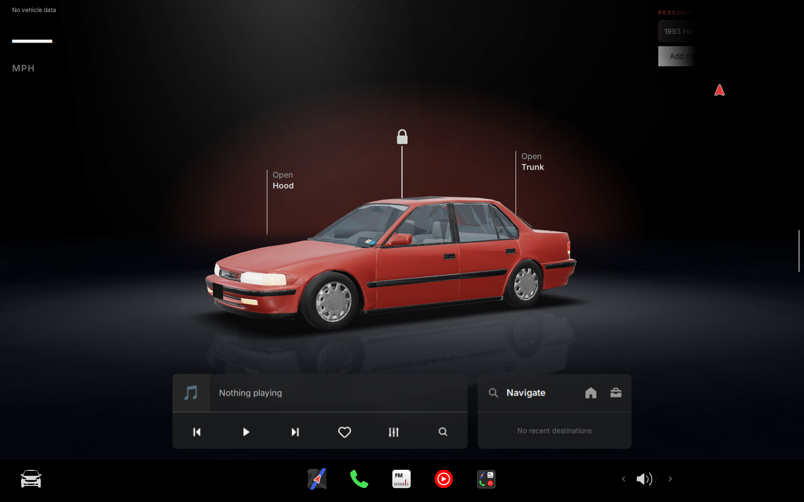
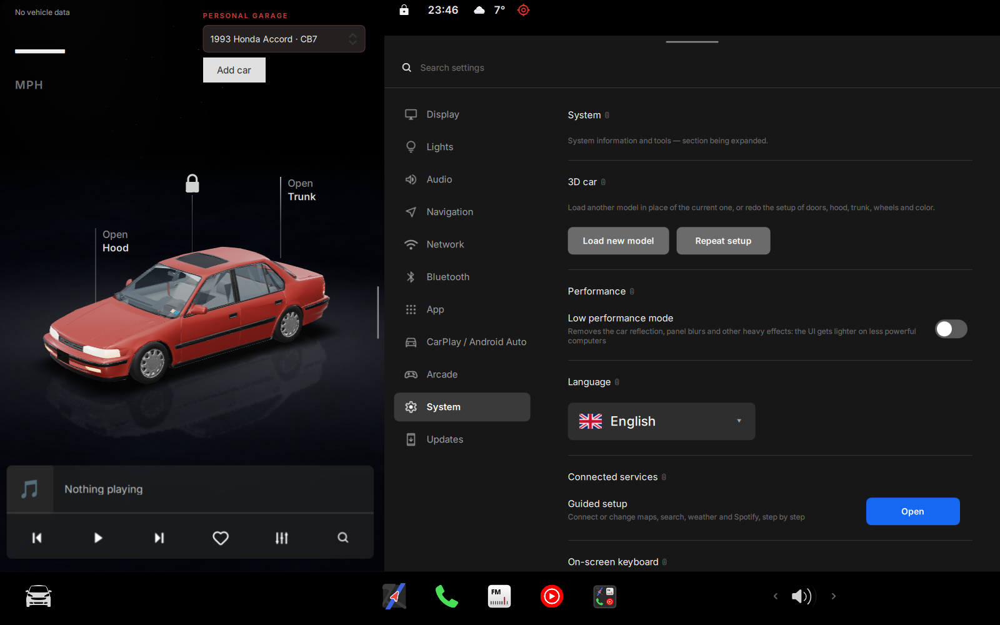

# AccordOS

**A Linux infotainment interface built around the 1993 Honda Accord CB7.**

Your Accord on screen, with an interactive 3D view, a persistent garage, and
navigation, music and phone features inherited from
[VoltaOS](https://github.com/Omardigio/VoltaOS).



*Captured directly from the AccordOS desktop build with the Accord model loaded.*

[Desktop setup](docs/accord-desktop.md) · [API keys](docs/api-keys.md) ·
[Documentation](#documentation) · [Report an issue](https://github.com/dexedrne/AccordOS/issues)

## Built for the CB7

AccordOS starts with the Accord selected and keeps the car at the center of the
interface. Rotate and zoom the model, try its doors, hood and trunk, and change
its paint and finish.

This fork adds:

- **A persistent garage.** Import another car without deleting the ones you
  already have. Switch models from the garage dropdown.
- **An appearance for each car.** Paint, finish, part assignments and layout stay
  with the selected vehicle and survive a restart.
- **Accord part recognition.** Support for the CB7 model's door, bonnet, bootlid
  and wheel naming. The local model's missing rear-door surfaces were also repaired.
- **Honest instrument displays.** Unavailable speed and vehicle status stay
  unavailable. The 3D controls animate the model; they do not operate the car.
- **Desktop startup.** Open a window first and configure online services when
  ready, without having to finish an account wizard to see the car.

The local garage catalog covers the Accord, Civic Coupe, Civic SiR, Civic LX,
Civic Type R, Toyota 4Runner, and Lexus IS 300, LS 400, LS 430 and ES 300.
You can import other GLB models through **Add car**.

## In the interface



*The Accord stays available alongside the app's settings and tools.*

## Maps, music and phone

The underlying VoltaOS application provides the rest of the dashboard:

| Feature | What's available | Setup |
| --- | --- | --- |
| Navigation | MapLibre maps, route planning and navigation UI | [Maps](docs/app/map.md), [API keys](docs/api-keys.md) |
| Music | Local and USB music, YT Music, Spotify, podcasts and radio | [Local music](docs/app/music.md), [Spotify](docs/app/spotify.md), [Radio](docs/app/radio.md) |
| Phone | Bluetooth audio, calls, contacts and messages | [Bluetooth](docs/app/bluetooth.md), [Phone](docs/app/phone.md) |
| Phone projection | CarPlay dongle support and native Android Auto code | [CarPlay / Android Auto](docs/app/carplay-androidauto.md) |
| Appearance | Light/dark themes, paint, finishes and car positioning | [Settings](docs/settings/README.md) |
| Desktop apps | Browser, theater and native app embedding | [Browser / theater](docs/app/theater-browser.md), [Arcade](docs/app/arcade.md) |

These features depend on their services, credentials and connected hardware.
Their presence in the interface does not mean every integration has been tested
in this fork.

## Run AccordOS

This is currently a **source-built desktop project**, not a ready-to-install
replacement for a car stereo. Use Linux with working OpenGL and a Wayland session
with XWayland available. A mouse works; a touchscreen is optional for desktop use.

```sh
git clone https://github.com/dexedrne/AccordOS.git
cd AccordOS
```

Follow the [desktop build guide](docs/accord-desktop.md) for the required Qt
modules, system packages and Python dependencies. The bundled MapLibre plugin
expects **Qt 6.11.1** and **ICU 76**; include Qt's `qtimageformats` module for
WebP textures inside GLB models.

Once built:

```sh
./start.sh                       # 1280 × 800 desktop window
./start.sh --window=1600x1000     # larger preview
```

Open **Settings → System → Guided setup** to connect maps and other services.
On Arch Linux, the Bluetooth file-transfer package is **`bluez-obex`**.

### Bring your own models

**The car model files shown in the screenshots are not included in this repo.**
They have their own source terms and are not relicensed under the application's GPL.

Import a GLB with **Add car**, or put your own licensed models in
[`assets/garage/`](assets/garage/README.md) using the filenames in
[`catalog.json`](assets/garage/catalog.json). The catalog seeds an empty garage;
it does not overwrite an existing one. Missing files are skipped.

Models, service keys, local settings and build artifacts stay out of Git.
[Model source credits](assets/garage/SOURCE-CREDITS.md) are retained separately.

## Documentation

- [AccordOS desktop setup and build notes](docs/accord-desktop.md)
- [Upstream installation and dependency reference](docs/installation.md)
- [API keys and connected services](docs/api-keys.md)
- [Interface guide](docs/interface.md)
- [Settings reference](docs/settings/README.md)
- [Supported peripherals](docs/hardware.md)
- [Troubleshooting](docs/troubleshooting.md) and [known upstream limitations](docs/known-issues.md)
- [Development and project structure](docs/development.md)

## Current status

The desktop application has been built on Linux and in Ubuntu under WSL.
Garage and appearance tests cover persistent selection, safe imports, separate
per-car settings, Accord part names and rejected truncated GLBs.

**An in-car installation has not been tested.** Vehicle telemetry, wiring,
ignition-controlled power and physical controls remain future installation work.
WSL graphics, Bluetooth and audio also need validation on the target computer.
There is no packaged AccordOS release yet.

## Credits and license

AccordOS is a fork of **[VoltaOS by Omar / Omardigio](https://github.com/Omardigio/VoltaOS)**.
The original Qt/QML interface, compositor and service integrations come from that
project. Copyright (C) 2026 Omar (Omardigio); the application remains available
under the **[GNU General Public License v3.0](LICENSE)**.

Built with Qt 6, C++, QML, Python, MapLibre and the other open-source projects
credited in the upstream documentation. Map data © OpenStreetMap contributors;
provider and service terms apply independently.

Vehicle models retain their original credits and licenses. Honda, Toyota,
Lexus and the other named brands are not affiliated with this project.
